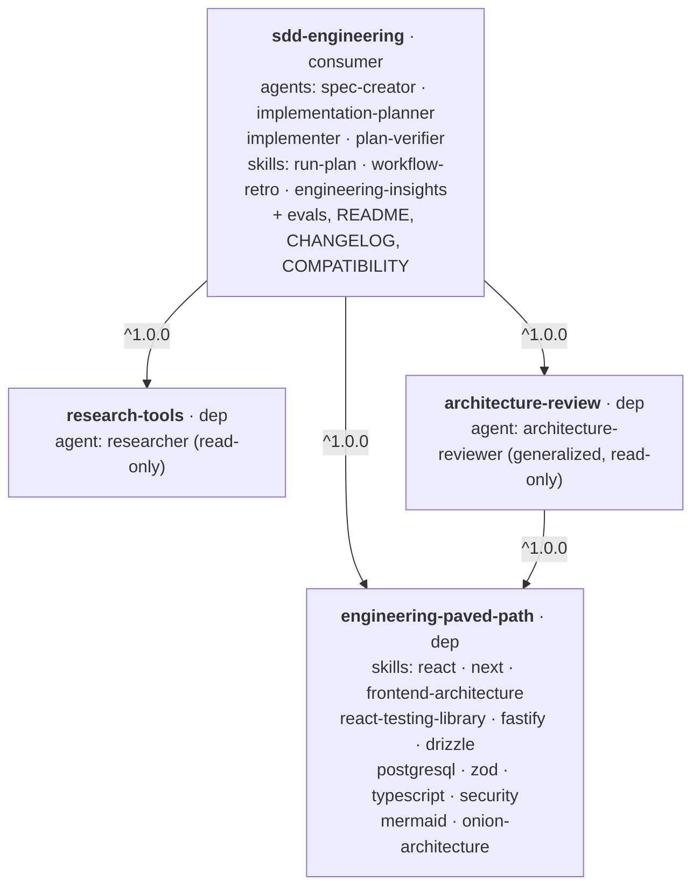
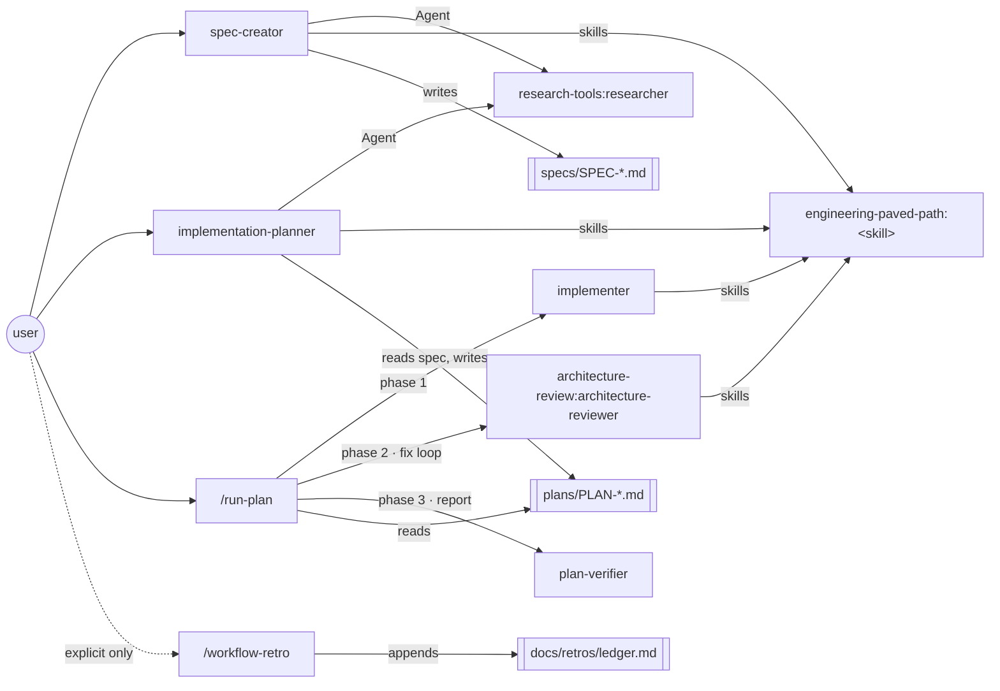
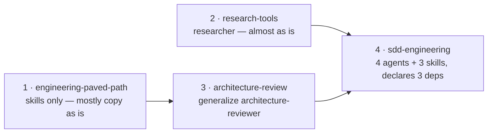

# Dependency graph — SDD plugin family

How the four plugins of this marketplace depend on and call each other.

## 1. Install time — who depends on whom

`/plugin install sdd-engineering@dev-digest-ai-marketplace` installs all
four: the resolver walks `dependencies`, finds tags
`{name}--v{version}` matching `^1.0.0`, installs the highest match.
`engineering-paved-path` is needed twice (by `sdd-engineering` and
`architecture-review`) — it is installed **once**, at the highest version
satisfying both ranges.

## 2. Runtime — how the consumer calls its dependencies (namespaced)

Own components (`spec-creator`, `plan-verifier`, `run-plan`, …) are
called by their plain names inside the plugin; components of a
**dependency** are always called by `<plugin>:<component>`.

## 3. Build / release order

`engineering-paved-path` and `research-tools` have no dependencies and
can be built in parallel; `architecture-review` needs
`engineering-paved-path`; `sdd-engineering` is always last. Tags follow
the same order: `engineering-paved-path--v1.0.0` →
`research-tools--v1.0.0` → `architecture-review--v1.0.0` →
`sdd-engineering--v1.0.0`.
