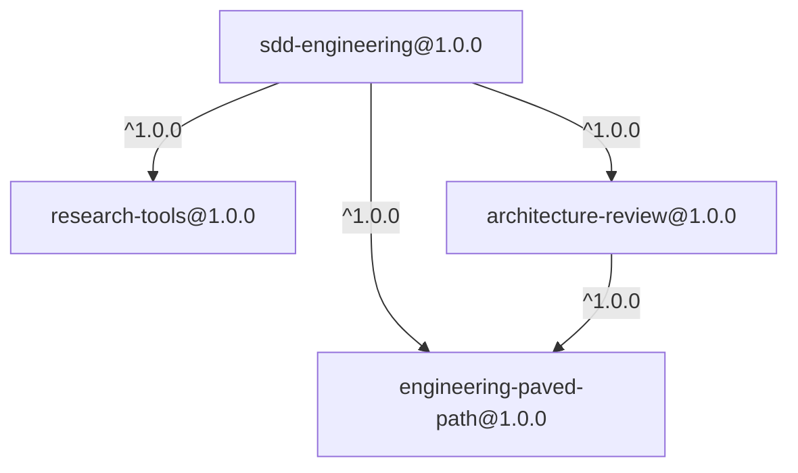
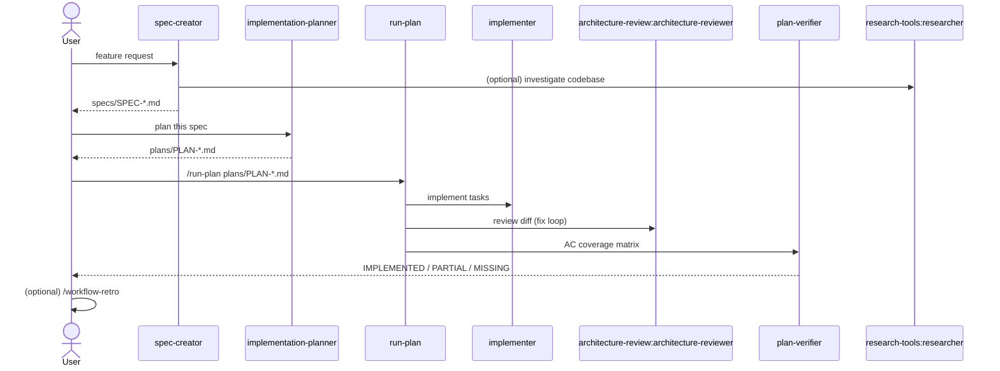

# Spec: SDD plugin family (sdd-engineering + 3 dependencies) | SPEC-2026-10-11-sdd-plugin-family | Status: draft
Supersedes: N/A
Related: `docs/PLUGIN-GUIDELINES.md`, `docs/RELEASES.md`, `docs/COST-BASELINE.md`, L08 lab steps 2–7

## Problem and why

The Spec-Driven Development workflow (spec → plan → implement → review →
verify) lives only in the Dev Digest product repo under `.claude/`. It is
bound to that repo's paths (`server/src`, `client/src`, `reviewer-core`,
`@devdigest/shared`), to its module names, and to the author's local
setup. Nobody can install it into another project; copying `.claude/`
would drag along product rules and personal state.

This spec defines four plugins that extract the reusable part of that
harness into this marketplace: one consumer plugin (`sdd-engineering`)
and three reusable dependency plugins.

## Goals / Non-goals

**Goals**

- Four installable plugins with clear boundaries, owners and versions.
- `sdd-engineering` installs with **one** command and pulls its three
  dependencies automatically.
- No component reads a Dev Digest-specific path, module or package name.
- Each instruction exists in exactly one place; dependency components are
  referenced by namespaced name.
- `sdd-engineering` ships a README that explains how the whole workflow
  fits together, plus `CHANGELOG.md` (versions/releases) and
  `COMPATIBILITY.md`.

**Non-goals**

- Catalog site (separate spec: `SPEC-2026-10-10-catalog-site.md`).
- Releasing / tagging (lab step 7) and installing into another project
  (lab step 8) — covered by `docs/RELEASES.md`; this spec only makes the
  plugins releasable.
- Cost experiment (lab step 8 / `docs/COST-BASELINE.md`).
- Moving Dev Digest's product-specific components (see "Stays in Dev
  Digest" below).
- Removing anything from the Dev Digest repo — it keeps its own copies
  until the plugins are proven in another project.

## Plugins and composition

### Dependency graph



Release order: `engineering-paved-path` → `research-tools` →
`architecture-review` → `sdd-engineering`.

### 1. `engineering-paved-path` — shared engineering skills (no deps)

Passive knowledge skills consumed by the SDD agents and the architecture
reviewer. One copy of each skill in the whole marketplace.

| Skill | Source in Dev Digest | Needed by | Adaptation |
|---|---|---|---|
| `react-best-practices` | `.claude/skills/react-best-practices` | implementer | copy as is |
| `next-best-practices` | `.claude/skills/next-best-practices` | implementer, architecture-reviewer | copy as is |
| `frontend-architecture` | `.claude/skills/frontend-architecture` (`rules/`) | spec-creator, planner, implementer, reviewer | remove the one `@devdigest/shared` import example |
| `react-testing-library` | `.claude/skills/react-testing-library` | implementer | copy as is |
| `fastify-best-practices` | `.claude/skills/fastify-best-practices` (`rules/`) | implementer, reviewer | copy as is |
| `drizzle-orm-patterns` | `.claude/skills/drizzle-orm-patterns` (`references/`) | implementer, reviewer | copy as is |
| `postgresql-table-design` | `.claude/skills/postgresql-table-design` | spec-creator, planner, implementer, reviewer | copy as is |
| `zod` | `.claude/skills/zod` (`references/`, `assets/`) | planner, implementer, reviewer | copy as is |
| `typescript-expert` | `.claude/skills/typescript-expert` (`references/`, `scripts/`) | planner, implementer, reviewer | scripts addressed via `${CLAUDE_SKILL_DIR}` |
| `security` | `.claude/skills/security` | spec-creator, implementer, reviewer | remove the `.claude/skills/` install path in `references.md` |
| `mermaid-diagram` | `.claude/skills/mermaid-diagram` | spec-creator, planner | copy as is |
| `onion-architecture` | `.claude/skills/onion-architecture` (`rules/`, `evals/`) | all SDD agents, reviewer | **generalize**: layer rules stay; Dev Digest examples (module names, `@devdigest/shared`, Fastify/Drizzle wiring of that repo) become generic or move to "example project" notes |

Every skill keeps its upstream attribution (source repo/URL, license) in
its own `README.md` — see [NEEDS CLARIFICATION] #1.

### 2. `research-tools` — read-only researcher (no deps)

| Component | Source | Adaptation |
|---|---|---|
| agent `researcher` | `.claude/agents/researcher.md` | remove the 8 Dev Digest references (package table, paths); tools stay read-only: `Read, Grep, Glob, LS, Bash, WebFetch, WebSearch` |

### 3. `architecture-review` — generalized reviewer (→ engineering-paved-path)

| Component | Source | Adaptation |
|---|---|---|
| agent `architecture-reviewer` | `.claude/agents/architecture-reviewer.md` | remove all 19 Dev Digest references; instead of hardcoded checks for `server/`, `client/`, `reviewer-core`, `@devdigest/shared`, the agent **reads the target repo's own architecture docs** (`CLAUDE.md`, `docs/architecture*.md`, `ARCHITECTURE.md`) and the layer rules from `engineering-paved-path:onion-architecture`; drop the reference to the Dev Digest-only `pr-self-review` skill; tools stay read-only |

### 4. `sdd-engineering` — the workflow (→ all three)

| Component | Source | Adaptation |
|---|---|---|
| agent `spec-creator` | `.claude/agents/spec-creator.md` | spec location becomes an explicit input (default `specs/`); remove 8 Dev Digest refs |
| agent `implementation-planner` | `.claude/agents/implementation-planner.md` | plan location explicit (default `plans/`); remove 13 Dev Digest refs (`@devdigest/shared`, module table) |
| agent `implementer` | `.claude/agents/implementer.md` | test/typecheck commands discovered from the target repo (`package.json`, `CLAUDE.md`); if none found → ask the user, never invent one; drop `pr-self-review` (Dev Digest-only) |
| agent `plan-verifier` | `.claude/agents/plan-viewer.md` | **renamed** from `plan-viewer`; remove 5 Dev Digest refs |
| skill `run-plan` | `.claude/skills/run-plan` | references `plan-verifier`, `architecture-review:architecture-reviewer`; phases unchanged |
| skill `workflow-retro` | `.claude/skills/workflow-retro` | jsonl parsing moved out of prose into `scripts/analyze_journals.py`, invoked via `${CLAUDE_SKILL_DIR}`; ledger path configurable (default `docs/retros/ledger.md`); Dev Digest checklist items (shared-contracts diff, `server/docs/architecture.md`) removed; runs **only** on explicit request |
| skill `engineering-insights` | `.claude/skills/engineering-insights` | module table (`client/`, `server/`, `reviewer-core/`…) replaced by "the repo's top-level packages/modules"; insights file path explicit |
| `evals/` | new | see Verification hints |
| `README.md` | new | how the workflow fits together (below) |
| `CHANGELOG.md` | new | version history and release SHAs |
| `COMPATIBILITY.md` | new | Claude Code ≥ 2.1.110 (version-constrained dependencies) |

### Stays in Dev Digest (not extracted)

`CLAUDE.md`, product specs/plans, `pr-self-review`, `dependency-checker`,
agents `brainstorm`, `doc-writer`, `quick-planner`, `security-reviewer`,
`test-writer`, hooks/settings, memory, caches.
Reason: product-specific, not used by the SDD workflow, or a separate
trust decision (`security-reviewer`, hooks).

## User stories

- As a developer in **any** repository, I install `sdd-engineering` once
  and can go from a feature request to a verified implementation without
  copying files.
- As a plugin maintainer, I fix a skill in `engineering-paved-path` once
  and every consumer gets it on the next update.
- As a reviewer of this marketplace, I can read `sdd-engineering/README.md`
  and understand which agent runs when, what it reads and what it writes.

## Acceptance criteria (EARS)

**Structure and registration**

- **AC-1** The marketplace shall register exactly four plugins in
  `.claude-plugin/marketplace.json`: `engineering-paved-path`,
  `research-tools`, `architecture-review`, `sdd-engineering`, each with
  `"source": "./plugins/<name>"`.
  observable: `jq '.plugins[].name'`; `claude plugin validate .` passes.
- **AC-2** Each plugin shall contain `.claude-plugin/plugin.json` (with
  `name`, `version` `1.0.0`, `description`, `author`), `README.md`,
  `CHANGELOG.md`, `COMPATIBILITY.md` and `evals/`.
  observable: file check per plugin; `claude plugin validate plugins/<name> --strict` passes.
- **AC-2a** Each `plugin.json` shall include `keywords[]` and
  `displayName`, and each skill/agent frontmatter shall include
  `keywords` — the catalog site (`scripts/build-index.mjs`) uses them for
  facets and search. The marketplace entry shall not carry `version`.
  observable: `jq '.keywords'`; frontmatter grep; validator passes.
- **AC-2b** WHEN `node scripts/smoke-install.mjs` runs, every plugin
  shall install in an isolated config and show as enabled, with all
  dependencies resolved inside this marketplace.
  observable: script exit code 0.
- **AC-3** `sdd-engineering/.claude-plugin/plugin.json` shall declare
  dependencies on `engineering-paved-path`, `research-tools` and
  `architecture-review`, each with range `^1.0.0`;
  `architecture-review` shall declare `engineering-paved-path@^1.0.0`.
  observable: `jq '.dependencies'`.
- **AC-4** `sdd-engineering/agents/` shall contain exactly
  `spec-creator.md`, `implementation-planner.md`, `implementer.md`,
  `plan-verifier.md`; `sdd-engineering/skills/` shall contain `run-plan/`,
  `workflow-retro/`, `engineering-insights/`.
  observable: `ls`.

**Decoupling from Dev Digest**

- **AC-5** IF any file under `plugins/sdd-engineering/agents/` or
  `plugins/architecture-review/agents/` matches
  `server/src|client/src|reviewer-core|@devdigest|DevDigest`, THEN
  validation shall fail.
  observable: `grep -rE` returns nothing (HW criteria #24, #35).
- **AC-6** The system shall not reference any path outside the plugin
  directory (`../`, `.claude/skills/`, `/Users/`).
  observable: `node scripts/validate-marketplace.mjs` + grep.
- **AC-7** `workflow-retro` shall invoke its supporting script as
  `${CLAUDE_SKILL_DIR}/scripts/analyze_journals.py`.
  observable: grep in `skills/workflow-retro/` (HW criterion #25).

**Namespacing and single source**

- **AC-8** Agents in `sdd-engineering` shall reference dependency
  components by namespaced name (`engineering-paved-path:<skill>`,
  `research-tools:researcher`, `architecture-review:architecture-reviewer`).
  observable: grep returns ≥ 1 hit per dependency (HW criterion #34).
- **AC-9** The system shall contain each skill in exactly one plugin; no
  plugin shall carry a copy of a dependency's skill.
  observable: skill directory names are unique across `plugins/*/skills/`.

**Behavior**

- **WHEN** a user asks for a spec, **AC-10** `spec-creator` shall ask the
  clarifying questions it needs and write a spec without implementation
  details to the configured spec location.
  observable: positive eval `evals/spec-creator-basic`.
- **AC-11** WHEN `implementation-planner` is given a spec, it shall build
  the plan from that spec and shall not add requirements absent from it.
  observable: eval compares plan tasks to spec ACs.
- **AC-12** WHEN `run-plan` executes a plan, it shall run implementer(s) →
  `architecture-review:architecture-reviewer` (scoped to the diff) →
  `plan-verifier`, and report the AC coverage matrix.
  observable: workflow eval transcript shows the three stages in order.
- **AC-13** IF `implementer` finds no test or typecheck command in the
  target repo, THEN it shall ask the user instead of inventing one.
  observable: eval on a repo without `package.json` scripts.
- **AC-14** WHILE no explicit retro request is made, `workflow-retro`
  shall not run.
  observable: negative eval — full workflow transcript contains no retro.
- **AC-15** IF the user request is unrelated to specs, plans or
  implementation (e.g. "explain this regex"), THEN no `sdd-engineering`
  agent shall activate.
  observable: negative eval.

**Documentation**

- **AC-16** `sdd-engineering/README.md` shall describe: use case, the
  component list, a workflow diagram (spec → plan → implement → review →
  verify → optional retro), where each artifact is written, the
  dependencies and why, requirements, install command, quick start,
  verification (smoke eval), support.
  observable: section headings present.
- **AC-17** Each plugin's `CHANGELOG.md` shall have a `1.0.0` entry with
  date and `Added` list; release SHA is filled in at tag time.
  observable: `grep "## \[1.0.0\]"`.

## Edge cases

- Target repo has no `CLAUDE.md` / architecture docs → `architecture-reviewer`
  falls back to the generic layer rules from `onion-architecture` and says
  so in its report.
- Target repo is not TypeScript → paved-path skills simply don't trigger;
  SDD agents still work (they are language-agnostic after generalization).
- Spec/plan directories already exist with other naming → agents follow
  the configured location, never move existing files.
- User also has local copies of the same agents (e.g. the Dev Digest repo
  itself) → document in README that local `.claude/agents/` shadow plugin
  agents; for verification use a repo without local copies.

## Workflows



## Non-functional

- **Least privilege:** `researcher`, `architecture-reviewer`,
  `plan-verifier` keep read-only tool lists; only `implementer` has
  `Edit/Write`.
- **Context cost:** agents' `skills:` preload lists stay minimal — skills
  that are needed only conditionally are mentioned in the prompt, not
  preloaded (input for the cost experiment).
- **Portability:** SKILL.md stays plain Markdown + frontmatter.

## Inputs (provenance)

- Dev Digest repo `main` @ `e821ee7`, directory `.claude/`.
- L08 lab text and slides (steps 2–7), HW8 criteria #15–#36.
- Upstream skill sources — see [NEEDS CLARIFICATION] #1.

## Untrusted inputs

Copied skills include third-party content (`references/`, `assets/`,
`scripts/`). Before `approved`, review them per `docs/SECURITY.md` →
"Review before a plugin becomes approved"; scripts are read in full.

## Verification hints

```
node scripts/validate-marketplace.mjs
claude plugin validate .
for p in plugins/*; do claude plugin validate "$p" --strict; done
claude --plugin-dir ./plugins/engineering-paved-path \
       --plugin-dir ./plugins/research-tools \
       --plugin-dir ./plugins/architecture-review \
       --plugin-dir ./plugins/sdd-engineering
```

In that session: run the positive/negative/workflow evals; confirm
`/agents` lists namespaced agents and that namespaced skills load without
warnings.

## [NEEDS CLARIFICATION]

1. **Upstream sources of the paved-path skills.** You said you will
   provide links to the original repositories. Each skill's `README.md`
   must name its source and license before release.
2. **`onion-architecture` scope.** Generalize it inside
   `engineering-paved-path` (proposed), or keep it Dev Digest-only and give
   `architecture-reviewer` only the generic rules it reads from the target
   repo?
3. **Agent `skills:` field with namespaced names.** Confirm during the
   `--plugin-dir` smoke test that `skills: [engineering-paved-path:zod]`
   in agent frontmatter resolves; if not, fall back to naming the skill
   in the prompt body.
4. **`engineering-insights` placement.** Lab puts it in `sdd-engineering`
   (proposed). Alternative: `engineering-paved-path`, if other plugins
   will use it.
