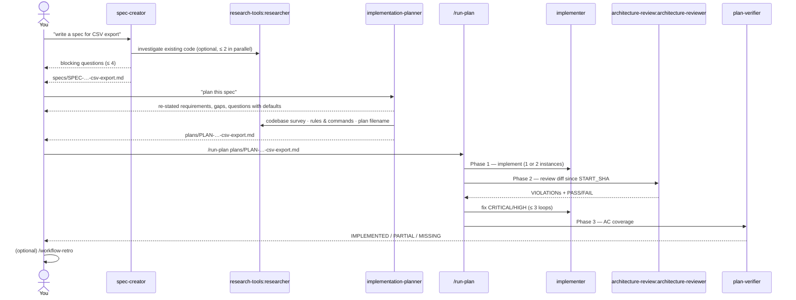

# SDD Engineering

**Spec-Driven Development for Claude Code** — take a feature from a one-line
request to a verified implementation through four specialised agents and an
orchestrating skill:

```
request → spec → plan → implement → architecture review → AC verification → (optional) retro
```

Works in any repository. Agents learn the project's layout, rules and
commands from the repository itself (`CLAUDE.md`, `AGENTS.md`, architecture
docs, `package.json`), so nothing about one specific project is baked in.

---

## Use case

You are about to build a non-trivial feature and want:

- requirements written down as **testable acceptance criteria** before any code,
- a **plan** with tasks, owned paths and verification steps derived from those
  criteria — not invented on the fly,
- implementation that **verifies itself** (typecheck, tests, ACs) and stays
  inside the plan's boundaries,
- an **independent architecture review** and an **AC coverage report** at the end.

For whom: developers and teams using Claude Code on real codebases, who want
a repeatable workflow instead of a one-shot "build this" prompt.

---

## Components

### Agents

| Agent | Role | Writes | Tools |
|---|---|---|---|
| `sdd-engineering:spec-creator` | Requirements engineer. Asks blocking questions (max 4), writes a spec with **EARS** acceptance criteria. No implementation details. | `specs/SPEC-YYYY-MM-DD-<name>.md` (or `{module}/specs/`, or the repo's own spec dir) | Read, Write, Grep, Glob, Bash, WebFetch, AskUserQuestion, Agent (researcher only) |
| `sdd-engineering:implementation-planner` | Verifies the spec (re-state → gaps → questions), then writes a machine-readable plan: tasks, owned paths, ACs, verification table, execution mode. | `plans/PLAN-YYYY-MM-DD-<name>.md` | Read, Write, Agent (researcher only) |
| `sdd-engineering:implementer` | Executes one scope of the plan (e.g. backend **or** frontend). Discovers the repo's typecheck/test commands, verifies after every phase and task, never leaves its owned paths. | source files in its owned paths | Read, Edit, Write, Bash, Grep, Glob |
| `sdd-engineering:plan-verifier` | Read-only traceability: maps every AC in the plan to production-code evidence → `IMPLEMENTED / PARTIAL / MISSING`. | nothing | Read, Grep, Glob, Bash, Skill |

### Skills

| Skill | What it does |
|---|---|
| `/run-plan <plan>` | Orchestrator: implementer(s) → architecture fix loop (max 3) → plan-verifier → summary. |
| `/workflow-retro [ledger]` | **Explicit request only.** Retrospective of a multi-agent session: tokens, cache hit %, cost, parallelism, duplicated reads, gaps, ≤ 5 action items. Uses the bundled `scripts/analyze_journals.py` (read-only). Appends one row to the ledger (default `docs/retros/ledger.md`). |
| `engineering-insights` | Records non-obvious discoveries (dead ends, quirks, decisions) into `{module}/insights/INSIGHTS.md`. Called by spec-creator and implementer at the end of their work. |

### Dependencies (installed automatically)

| Plugin | Why `sdd-engineering` needs it |
|---|---|
| [`engineering-paved-path`](../engineering-paved-path/README.md) `^1.0.0` | Technical skills the agents load by namespaced name — `engineering-paved-path:onion-architecture`, `:zod`, `:typescript-expert`, `:security`, `:react-best-practices`, … One copy for the whole marketplace. |
| [`research-tools`](../research-tools/README.md) `^1.0.0` | `research-tools:researcher` — the only sub-agent spec-creator and implementation-planner may spawn for codebase / web investigation. |
| [`architecture-review`](../architecture-review/README.md) `^1.0.0` | `architecture-review:architecture-reviewer` — the independent review gate in `/run-plan` Phase 2. |

```
sdd-engineering@1.0.0
├── engineering-paved-path@^1.0.0
├── research-tools@^1.0.0
└── architecture-review@^1.0.0
    └── engineering-paved-path@^1.0.0   (installed once, shared)
```

---

## How it works together



| Step | You run | Reads | Produces |
|---|---|---|---|
| 1. Spec | "write a spec for …" | your request, design links, repo docs, `insights/` | `SPEC-*.md` |
| 2. Plan | "plan `specs/SPEC-….md`" | the spec, repo rules and commands | `PLAN-*.md` |
| 3. Build | `/run-plan plans/PLAN-….md` | the plan | code changes + summary report |
| 4. Retro *(optional)* | `/workflow-retro` | session transcripts | dashboard in chat + one ledger row |

Gates you will see: spec-creator stops for blocking questions; the planner
stops for gap questions and execution mode; implementers stop if a command is
missing, a file is outside owned paths, or an AC fails; `/run-plan` stops if
typecheck/tests fail or CRITICAL/HIGH violations remain after 3 loops.

---

## Requirements

| Requirement | Detail |
|---|---|
| Claude Code | **≥ 2.1.110** (version-constrained plugin dependencies). See [`COMPATIBILITY.md`](COMPATIBILITY.md). |
| Git | The repository must be a git repo (`START_SHA` scopes reviews to your diff). |
| Python 3 | Only for `/workflow-retro` (bundled script, standard library only). |
| Network | `WebFetch` in spec-creator (design links) and workflow-retro (model prices); researcher uses `WebSearch`/`WebFetch` in web mode. No other network access. |
| Secrets | None. The plugin declares no secret slots and reads no credentials. |
| Write access | Only `implementer` edits source files (`permissionMode: acceptEdits`), confined to the plan's owned paths. spec-creator writes only spec files, implementation-planner only plan files, workflow-retro only its ledger row. |

---

## Installation

Project scope (recommended — commits the setting for your team):

```
claude plugin marketplace add yudbox/dev-digest-ai-marketplace --scope project
claude plugin install sdd-engineering@dev-digest-ai-marketplace --scope project
```

User scope (just you, all projects):

```
/plugin marketplace add yudbox/dev-digest-ai-marketplace
/plugin install sdd-engineering@dev-digest-ai-marketplace
```

The installer pulls `engineering-paved-path`, `research-tools` and
`architecture-review` automatically. Then run `/reload-plugins` (or start a
new session).

> If your repository already has local copies of these agents in
> `.claude/agents/`, the local files take precedence. Remove or rename them,
> otherwise you will not know which version ran.

---

## Quick start

In a repository with at least a `README.md` or `CLAUDE.md`:

```
write a spec for adding CSV export to the orders list
```

Expected: `sdd-engineering:spec-creator` activates, prints a complexity
signal, asks up to 4 blocking questions, then writes
`specs/SPEC-<today>-csv-export.md` with EARS acceptance criteria. Then:

```
plan specs/SPEC-<today>-csv-export.md
/run-plan plans/PLAN-<today>-csv-export.md
```

---

## Verification (smoke test)

```
claude plugin list --json | jq '.[] | select(.name|test("sdd-engineering|engineering-paved-path|research-tools|architecture-review")) | {name, version, enabled}'
```

All four should be listed and enabled. Then in a new session:

1. `/agents` shows `sdd-engineering:spec-creator`, `sdd-engineering:implementation-planner`,
   `sdd-engineering:implementer`, `sdd-engineering:plan-verifier`,
   `research-tools:researcher`, `architecture-review:architecture-reviewer`.
2. Ask "write a spec for <small feature>" → spec-creator activates and the spec appears in the documented path.
3. Ask "explain this regex: `^a+$`" → **no** sdd-engineering agent activates.

Behavior cases live in [`evals/`](evals/README.md).

---

## Support

| | |
|---|---|
| Primary owner | @yudbox |
| Backup owner | _not assigned yet_ |
| Questions & bugs | [GitHub issues](https://github.com/yudbox/dev-digest-ai-marketplace/issues) — label `sdd-engineering` |
| Changes | via pull request, see the marketplace [`CONTRIBUTING.md`](../../CONTRIBUTING.md) |
| Versions | [`CHANGELOG.md`](CHANGELOG.md) · compatibility: [`COMPATIBILITY.md`](COMPATIBILITY.md) |
